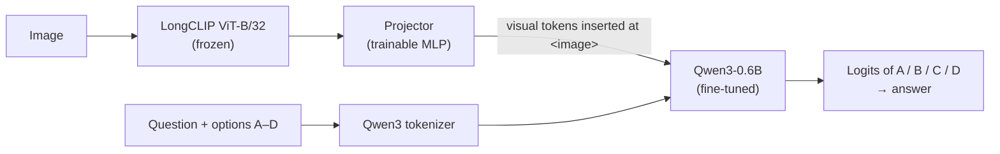

# Custom LLaVA for Multiple-Choice Visual Question Answering

A LLaVA-style vision-language model built from scratch by connecting a **LongCLIP ViT-B/32** vision encoder to the **Qwen3-0.6B** language model, trained to answer multiple-choice questions about images.

MSc Artificial Intelligence coursework, Queen Mary University of London (Neural Networks & NLP, 2026).

## Overview

The dataset has ~11.6K images and ~65K four-option multiple-choice questions: 56K for training, 3.3K for validation and 5.5K for testing.

The project had two stages:

1. **Image–question reconstruction.** The validation and test questions came without their images. I recovered each question's image by retrieving it from its caption with LongCLIP embeddings.
2. **VQA model.** I built and trained the vision-language model, then ran experiments to improve it.

## 1. Caption-to-image retrieval: 99.83% Recall@1

- Encoded all 1,600 candidate images and each caption with LongCLIP, using L2-normalised embeddings.
- Matched each caption to its most similar image by cosine similarity (`argmax`), then propagated the image path to every question linked to that caption.
- On 600 validation captions, **99.83% were matched to the correct image out of 1,600 candidates** (zero-shot, no training).

## 2. Building the model

| Component | Implementation |
|---|---|
| Vision encoder | LongCLIP ViT-B/32 vision tower, frozen; patch-level features (`last_hidden_state`) |
| Projector | MLP mapping CLIP features into Qwen3's embedding space |
| Fusion | A custom `<image>` token is added to the tokenizer. Its embedding is replaced by the projected visual tokens, with attention masks and left-padding handled per sample |
| Language model | Qwen3-0.6B, fully fine-tuned together with the projector (~598M trainable parameters) |
| Training objective | Cross-entropy on the final-position logits of the four answer-letter tokens |
| Inference | Logit-restricted decoding: pick the highest of the A/B/C/D logits instead of free generation, so every output is a valid option |
| Training setup | AdamW (lr 1e-4, weight decay 0.01), cosine annealing, batch size 8, 3 epochs, gradient clipping at 1.0 |

## 3. Experiments

Validation accuracy (3,300 questions, random guessing = 25%):

| Experiment | Change | Val accuracy |
|---|---|---|
| Baseline | 2-layer MLP projector (Linear → GELU → Linear) | 50.94% |
| **Enhanced projector** | 3-layer MLP with LayerNorm + GELU between layers | **54.36%** (+3.4 pts) |
| Warmup + cosine schedule | 5% linear warmup, peak lr 2e-4, cosine decay | 48.64% |
| Improved prompt | More explicit instruction and a clearer answer cue | not measured reliably* |

\* The prompt experiment saved its predictions to a separate file but evaluated the previous experiment's prediction file, so the printed 54.36% is a duplicate of the enhanced-projector result. It reached the lowest training loss of all runs (0.92), but its validation accuracy was not measured. See the note in the notebook.

**What I took from it**
- The projector is the bottleneck between two separately pretrained representation spaces. Adding depth and normalisation there gave the clearest gain.
- A higher peak learning rate with warmup hurt accuracy. With a randomly initialised projector and only 3 epochs, the larger updates appear to destabilise training rather than help it.
- The enhanced-projector model was used for the final test-set submission.

## Repository contents

- [`llava_vqa.ipynb`](llava_vqa.ipynb): full pipeline (retrieval, model, training, experiments) with the original run outputs. It was run on a Google Colab GPU.
- [`requirements.txt`](requirements.txt): Python dependencies (the run used Transformers 5.0.0).

The dataset was provided by the module and is not included. The module supplied the notebook template, the task descriptions and the evaluation functions. The retrieval method, model implementation, training loop, inference and experiments are my work.

## Models

- Vision: [`AlpachinoNLP/LongCLIP-ViT-B-32`](https://huggingface.co/AlpachinoNLP/LongCLIP-ViT-B-32)
- Language: [`Qwen/Qwen3-0.6B`](https://huggingface.co/Qwen/Qwen3-0.6B)

Built with PyTorch and Hugging Face Transformers.
